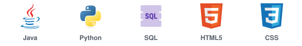
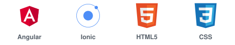

💻 **Desarrollo de software** &nbsp;|&nbsp; 📝 **Documentación técnica** &nbsp;|&nbsp; 📋 **Gestión de proyectos** &nbsp;|&nbsp; 🔎 **Análisis de requisitos**

## 🌸 Sobre mí

🎓 Soy estudiante de **Ingeniería de Sistemas** en la **Corporación Universitaria del Huila – CORHUILA**, en Colombia. Me apasiona el **desarrollo de software**, la **documentación técnica** y la **gestión de proyectos de tecnología**.

🩺 Actualmente contribuyo en **TeleMed IA**, una plataforma académica de telemedicina, y 🔬 soy integrante e investigadora del **Semillero de Investigación Sociedad NTIC**.

🤝 Disfruto trabajar en equipo, organizar soluciones y aprender construyendo proyectos reales. Me caracterizo por mi dedicación, mi capacidad de aprendizaje y mi disposición para asumir nuevos retos. 🚀

## 🛠️ Tecnologías y herramientas

<h3 align="center">💻 Lenguajes</h3>

Java es mi lenguaje principal para el backend y Python lo uso para el análisis de datos.

<h3 align="center">⚙️ Desarrollo backend</h3>

APIs REST con Spring Boot, validaciones, pruebas unitarias y de integración, y documentación con OpenAPI.

<h3 align="center">🎨 Desarrollo frontend y móvil</h3>

Aplicaciones web con Angular y Angular Material, apps móviles con Ionic e integración con APIs REST.

<h3 align="center">🗄️ Bases de datos</h3>

Modelos de datos, consultas SQL y restricciones de integridad.

<h3 align="center">☁️ DevOps y nube</h3>

Git Flow con <i>pull requests</i> y revisiones de código, contenedores con Docker, integración continua y despliegue en Azure.

<h3 align="center">📝 Documentación y gestión de proyectos</h3>

Documentación técnica, análisis de requisitos, planes de trabajo por fases, decisiones técnicas y trazabilidad entre requisitos y pruebas.

<h3 align="center">🌐 Redes y telemática</h3>

Conocimientos básicos: direccionamiento IP y subredes, configuración de routers y switches con Cisco IOS y simulación de redes.

<h3 align="center">🧰 Herramientas</h3>

Editores de código, pruebas de APIs, diseño de interfaces y organización de tareas.

## ✨ Habilidades

<table>
  <tr>
    <th align="left" width="50%">🧠 Técnicas</th>
    <th align="left" width="50%">💛 Personales</th>
  </tr>
  <tr>
    <td valign="top">
      Desarrollo backend y APIs REST 
      Desarrollo frontend 
      Bases de datos 
      Pruebas de software 
      Contenedores e integración continua 
      Documentación técnica 
      Análisis de requisitos 
      Fundamentos de redes
    </td>
    <td valign="top">
      Trabajo en equipo 
      Dedicación y constancia 
      Organización 
      Comunicación 
      Resolución de problemas 
      Aprendizaje continuo 
      Adaptación a nuevas tecnologías
    </td>
  </tr>
</table>

## 🚀 Proyecto destacado

### 🩺 TeleMed IA

Plataforma académica de telemedicina desarrollada en equipo.

- 👩‍💻 Contribuyo en los dominios de **Gestión de Profesionales** y **Generación de Documentos**.
- 📄 Elaboro la **documentación técnica** de esos dominios.
- 🔀 Trabajo de forma colaborativa con ramas, *pull requests* y revisiones de código.

## 📊 Estadísticas

<picture>
  <source media="(prefers-color-scheme: dark)" srcset="https://github-profile-summary-cards.vercel.app/api/cards/profile-details?username=Sofialjure&theme=github_dark" />
  
</picture>

<picture>
  <source media="(prefers-color-scheme: dark)" srcset="https://github-profile-summary-cards.vercel.app/api/cards/stats?username=Sofialjure&theme=github_dark" />
  
</picture>
<picture>
  <source media="(prefers-color-scheme: dark)" srcset="https://github-profile-summary-cards.vercel.app/api/cards/most-commit-language?username=Sofialjure&theme=github_dark" />
  
</picture>

<b>🔥 Ver mi racha de contribuciones</b>

 

<picture>
  <source media="(prefers-color-scheme: dark)" srcset="https://streak-stats.demolab.com?user=Sofialjure&locale=es&hide_border=true&theme=github-dark-blue&ring=C9A227&fire=C9A227&currStreakLabel=C9A227" />
  
</picture>

## 📫 Contacto

